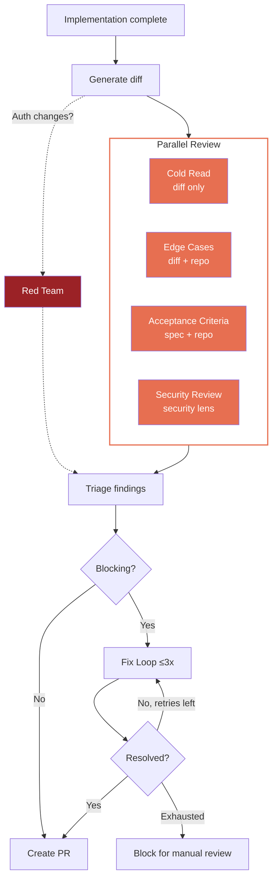

# Code Review Process

This document describes how code quality is enforced across the auth workspace using independent review agents.

## Why Independent Review Contexts

The auth workspace uses AI-driven development loops (Ralph Orchestrator) to implement features autonomously. Early on, code reviews were performed within the same conversation context as the implementation — the reviewer had already "seen" the code it wrote and was biased toward confirming its own work.

**The result:** Reviews were shallow. They found surface-level style issues but missed real bugs, security vulnerabilities, and logic errors. PRs #178-181 in identity-stack demonstrated the problem: reviews passed, but independent re-review found dozens of genuine issues including cross-tenant IDOR vulnerabilities, privilege escalation paths, and resource leaks.

**The fix:** Each reviewer runs in a completely fresh context with zero access to the implementation plan, task-state, or conversation history. They read the code cold.

## Review Agent Personas

Five specialized reviewers, each designed to catch a different class of defects:

### Cold Read

**Mindset:** Cynical, jaded, expects problems. Zero project context — sees only the diff.

**What it catches:**
- Logic errors (off-by-one, inverted conditions, wrong operator)
- Missing error handling (swallowed exceptions, unhandled I/O)
- Security vulnerabilities (injection, auth bypass, credential exposure)
- API contract violations (wrong status codes, missing fields)
- Race conditions (TOCTOU, concurrent access without locks)
- Dead code (unused imports, unreachable branches)
- Resource leaks (unclosed connections, missing cleanup in error paths)

**Output format:** MUST FIX (blocks merge) / SHOULD FIX (quality risk) / NITPICK (style only)

**Template:** [`review-agents/blind-hunter.md`](https://github.com/jamescrowley321/identity-stack-planning/blob/main/_bmad-output/implementation-artifacts/ralph-prompts/review-agents/blind-hunter.md)

### Edge Cases

**Mindset:** Pure path tracer. Methodical, exhaustive, emotionless. Walks every branch.

**What it catches:**
- Unhandled branching paths (if/else, try/except, early returns)
- Domain boundary violations (null, empty, zero-length, negative, max int)
- Async gaps (unhandled exceptions in awaited calls, missing timeouts)
- Type boundary misses (Optional not checked, dict key misses, list index errors)
- Integration boundary failures (HTTP timeouts, empty DB results, service outages)

**Output format:** Table with location, trigger condition, guard snippet, and consequence severity ([CRASH] / [DATA] / [WRONG] / [DEGRADED])

**Template:** [`review-agents/edge-case-hunter.md`](https://github.com/jamescrowley321/identity-stack-planning/blob/main/_bmad-output/implementation-artifacts/ralph-prompts/review-agents/edge-case-hunter.md)

### Acceptance Criteria

**Mindset:** Literal, unforgiving contract lawyer. Checks every acceptance criterion.

**What it catches:**
- Missing implementations (AC specified but not coded)
- Missing tests (AC implemented but not verified)
- Implementation drift (code does something different than the AC intended)
- Scope creep (code added beyond what the AC requires)
- Architecture violations (patterns that contradict documented decisions)

**Output format:** PASS / FAIL / PARTIAL / SCOPE CREEP per acceptance criterion. FAIL and unresolved PARTIAL block merge.

**Template:** [`review-agents/acceptance-auditor.md`](https://github.com/jamescrowley321/identity-stack-planning/blob/main/_bmad-output/implementation-artifacts/ralph-prompts/review-agents/acceptance-auditor.md)

### Security Review (Security Auditor)

**Mindset:** Pragmatic, experienced, calibrated. Reports only genuinely exploitable vulnerabilities. Never cries wolf.

**What it catches:**
- Tenant isolation failures (tenant A accessing tenant B's data)
- Authorization bypass (non-admin reaching admin endpoints, fail-open defaults)
- Injection (SQL, command, template, header)
- Authentication integrity gaps (JWT validation, token confusion, issuer validation)
- Credential exposure (secrets in logs, error responses, version control)
- SSRF (user-controlled URLs reaching backend HTTP clients)
- Sync/ordering issues (partial failures leaving inconsistent auth state)

**Output format:** BLOCK (CONFIRMED/LIKELY — must include concrete attack scenario) / WARN (LIKELY/UNLIKELY) / INFO (acceptable risk). Overall: PASS or FAIL.

**Template:** [`review-agents/sentinel.md`](https://github.com/jamescrowley321/identity-stack-planning/blob/main/_bmad-output/implementation-artifacts/ralph-prompts/review-agents/sentinel.md)

### Red Team (Red Team)

**Mindset:** Offensive security specialist. Activated only for high-risk changes.

**Trigger:** Changes touching auth middleware, token validation, JWT handling, infrastructure config, or security-sensitive code.

**What it does (3-stage pipeline):**
1. **Recon** — Map the attack surface from the diff: authentication boundaries, authorization checks, data flows, external inputs
2. **Vulnerability Analysis** — Probe for: auth bypass, privilege escalation, injection chains, token confusion, IDOR, middleware ordering exploits, infrastructure escape
3. **Exploit Validation** — For each finding: concrete step-by-step exploitation, prerequisites, CVSS v3.1 scoring

**Output format:** CRITICAL / HIGH / MEDIUM / LOW with attack scenarios, prerequisites, CVSS scores, and remediation steps.

**Template:** [`review-agents/viper.md`](https://github.com/jamescrowley321/identity-stack-planning/blob/main/_bmad-output/implementation-artifacts/ralph-prompts/review-agents/viper.md)

## Review Flow in Ralph Loops

**Key properties:**
- Reviewers are selected by diff scope (`phases/review.md` Step 2) and spawned in parallel, with no shared context between them; a docs-only diff gets Acceptance Criteria alone
- Red Team is conditional: it joins the same parallel batch for auth/middleware/token/infrastructure changes
- Each reviewer is a separate Claude Code subagent spawned with a fresh context
- The fix loop re-reviews only the delta: it re-runs the reviewers that had P0/P1 findings, scoped to the fix commits (`phases/review-fix.md`)
- P0 findings that survive 3 fix iterations block the task for manual intervention

## Finding Severity Triage

The review-fix phase triages every finding into three tiers (`phases/review-fix.md`):

| Tier | Findings | Handling |
|---|---|---|
| **P0** (blocks merge) | Security BLOCK, Acceptance FAIL, MUST FIX, Edge Cases [CRASH] / [DATA], Red Team CRITICAL / HIGH | Always fixed |
| **P1** (should fix) | WARN, SHOULD FIX, PARTIAL, [DEGRADED], [WRONG], MEDIUM | Fixed where straightforward |
| **P2** | NITPICK, LOW, INFO | Skipped unless trivial |

## Manual Blind Peer Review

For full codebase re-reviews outside of ralph loops (e.g., when prior in-context reviews were shallow), run the **`blind-peer-review:check`** skill. It dispatches eight fresh-context lenses — Cold Read, Edge Cases, Acceptance Criteria, Security Review, Red Team, Policy & Provenance, OWASP Web, OWASP LLM — each with no access to the implementation conversation. All eight are on by default.

This replaces the standalone `pim-adversarial-review.md` prompt, which required manually opening a fresh session. The review covers:
1. Architectural reconnaissance (read key files to understand the codebase)
2. Red team security review (JWT attacks, OIDC exploitation, protocol flow attacks)
3. Blind code review (sync/async parity, error paths, resource lifecycle, thread safety)
4. Edge case exhaustion (boundary inputs across every public function)
5. Test coverage audit (untested attack scenarios, missing error path tests)

**To use:** in a Claude Code session in the target repository, run the `blind-peer-review:check` skill (pass `--base origin/<branch>` to review a branch). In CI, `@claude review this PR` on a pull request runs the same skill (`.github/workflows/claude.yml`).

## Review Findings History

Past review findings are tracked in:
- `review-findings-identity-stack.md` — 44 MUST FIX, 85 SHOULD FIX, 51 DEFER across 12 PRs (all resolved). Compressed into the [archive index](https://github.com/jamescrowley321/identity-stack-planning/blob/main/_archive/README.md), which names the `git show` command to read it back.
- Individual task-state files record per-PR findings during ralph loop execution
