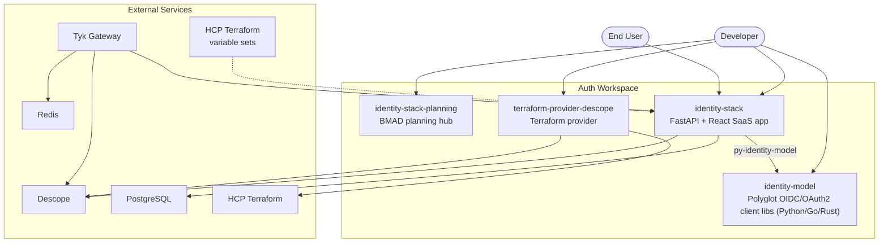
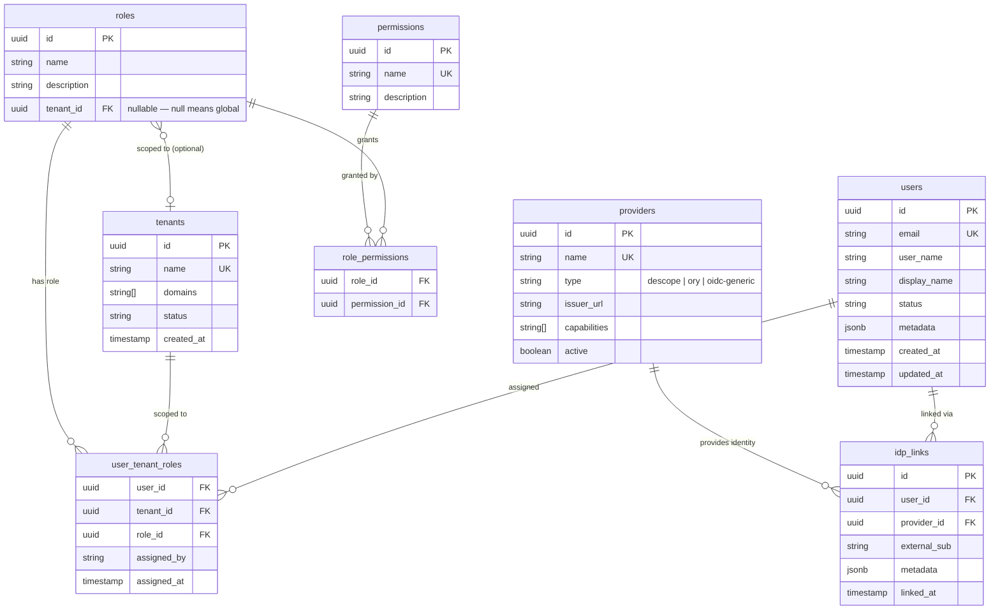
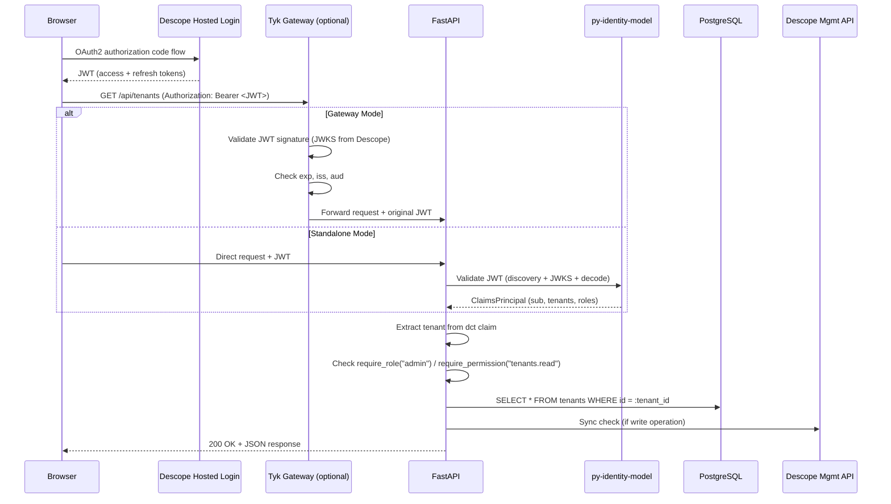
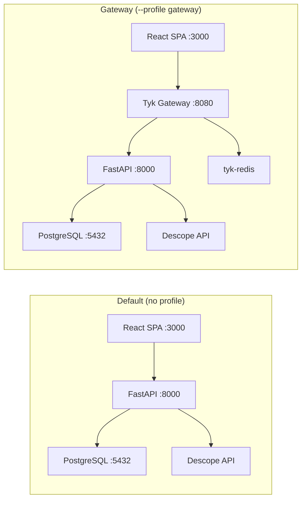
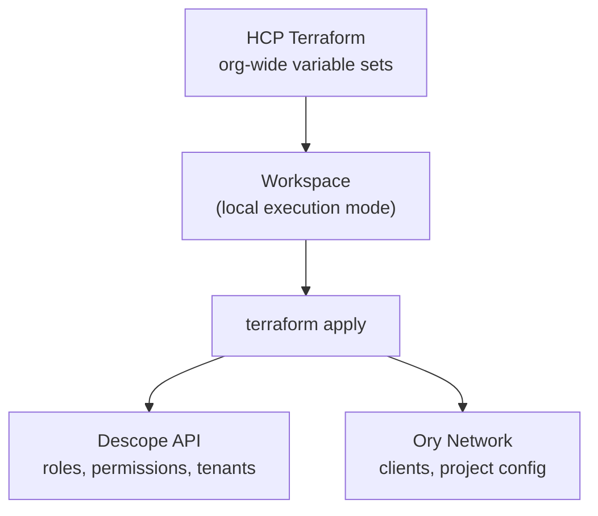

# System Architecture

Unified technical overview of the auth workspace. For the decisions behind it, see the [consolidated ADR index](#consolidated-adr-index) below; for the tracks, the [roadmap](roadmap.md).

## System Context



## Component Architecture

### identity-model — Python (`py/`, package `py-identity-model`)

```
+---------------------------------------------------------+
|                   Public API Surface                     |
|  __init__.py (sync re-exports)                          |
|  sync/__init__.py          aio/__init__.py              |
+---------------------------------------------------------+
|              Sync Wrappers          Async Wrappers       |
|  sync/discovery.py          aio/discovery.py            |
|  sync/jwks.py               aio/jwks.py                |
|  sync/token_validation.py   aio/token_validation.py     |
|  sync/token_client.py       aio/token_client.py         |
|  sync/introspection.py      aio/introspection.py        |
|  sync/revocation.py         aio/revocation.py           |
|  sync/userinfo.py           aio/userinfo.py             |
|  + par, jarm, device_auth, token_exchange, id_token,    |
|    logout, registration, managed_client                 |
+---------------------------------------------------------+
|                 Shared Business Logic                    |
|  core/discovery_logic.py    core/jwks_logic.py          |
|  core/token_validation_logic.py                         |
|  core/validators.py         core/models.py              |
|  core/pkce.py               core/token_client_logic.py  |
|  core/dpop.py               core/fapi.py                |
|  core/introspection_logic.py                            |
|  core/revocation_logic.py   core/id_token_logic.py      |
|  core/jar.py                core/par_logic.py           |
|  core/device_auth_logic.py  core/token_exchange_logic.py|
|  core/logout_logic.py       core/registration_logic.py  |
+---------------------------------------------------------+
|                    HTTP Layer                            |
|  sync/http_client.py        aio/http_client.py          |
|  (threading.local)          (singleton + lock)           |
|  ssl_config.py              core/http_utils.py          |
+---------------------------------------------------------+
|                   Dependencies                          |
|  PyJWT (decode/verify)  httpx (HTTP)  cryptography (DPoP)|
+---------------------------------------------------------+
```

**Protocol coverage:** Discovery (RFC 8414), JWKS (RFC 7517), JWT Validation (RFC 7519), Auth Code + PKCE (RFC 7636), DPoP (RFC 9449), PAR (RFC 9126), JAR (RFC 9101), Device Auth (RFC 8628), Token Exchange (RFC 8693), Introspection (RFC 7662), Revocation (RFC 7009), Refresh (RFC 6749 §6), FAPI 2.0 Security Profile.

### identity-model

One cross-language OIDC/OAuth2 client-library monorepo with a shared conformance `spec/`. Python lives in `py/` (package `py-identity-model`) and is the reference implementation the Go and Rust libraries match. **Go** and **Rust** ship Core (except configuration) plus introspection, revocation and token exchange; Go also ships DPoP, which is in progress in Rust. Per-language status is in [`spec/capabilities.md`](https://github.com/jamescrowley321/identity-model/blob/main/spec/capabilities.md) (checked 2026-11-01). Toolchains: Go 1.26, Rust MSRV 1.96. The 2026-09-05 source-verified state and the sequenced plan live in [`identity-model-parity-report-2026-09-05.md`](https://github.com/jamescrowley321/identity-stack-planning/blob/main/_bmad-output/planning-artifacts/identity-model-parity-report-2026-09-05.md).

### identity-stack

```
+---------------------------------------------------------------+
|                        React Frontend                          |
|  react-oidc-context + oidc-client-ts                          |
|  shadcn/ui + Tailwind CSS v4                                  |
|  OAuth2 authorization code flow → Descope (or Ory) login      |
+---------------------------------------------------------------+
        |                                      |
        | /api/* (proxy in dev)                | OIDC login
        v                                      v
+---------------------------------------------------------------+
|                        FastAPI Backend                          |
|                                                                |
|  Middleware Stack (outermost → innermost):                     |
|  1. ProxyHeadersMiddleware    (X-Forwarded-For)               |
|  2. SecurityHeadersMiddleware (CSP, HSTS, X-Frame-Options)    |
|  3. SlowAPIMiddleware         (rate limiting) *               |
|  4. TokenValidationMiddleware (py-identity-model) *           |
|  5. CORSMiddleware                                            |
|                                                                |
|  * Gateway mode drops SlowAPI and replaces token validation   |
|    with GatewayClaimsMiddleware (Tyk validates the JWT)       |
|                                                                |
|  +------------------+  +------------------+  +---------------+|
|  | Auth Routers     |  | Domain Routers   |  | Health        ||
|  | /api/auth/*      |  | /api/... users,  |  | /api/health   ||
|  | session, tenant  |  | roles, perms,    |  |               ||
|  | switch, logout   |  | tenants, fga     |  |               ||
|  +--------+---------+  +--------+---------+  +---------------+|
|           |                      |                             |
|           v                      v                             |
|  +--------------------------------------------------+         |
|  |   Per-domain services (services/user.py, ...)     |         |
|  |  Returns Result[T, IdentityError]                 |         |
|  |  (IdentityService ABC defined, not implemented)   |         |
|  +--------------------------------------------------+         |
|           |                      |                             |
|  +--------v----------+  +-------v-----------------+           |
|  | PostgreSQL 16     |  | IdentityProviderAdapter |           |
|  | (canonical store) |  |   DescopeSyncAdapter    |           |
|  | 9 identity tables |  |   OrySyncAdapter        |           |
|  |                   |  |   NoOpSyncAdapter       |           |
|  +-------------------+  +-------------------------+           |
+---------------------------------------------------------------+
        |                           |
        v                           v
   PostgreSQL               Descope Management API
   (source of truth)        (sync target)
```

### terraform-provider-descope

```
+------------------------------------------+
|           Terraform Provider              |
|  provider.go (Configure, Schema)         |
+------------------------------------------+
|              Resources (CRUD)             |
|  descope_project      descope_sso        |
|  descope_permission   descope_role       |
|  descope_tenant       descope_access_key |
|  descope_fga_schema   descope_descoper   |
|  descope_management_key  descope_engine  |
|  descope_inbound_app                     |
|  descope_sso_application                 |
|  descope_password_settings               |
|  descope_outbound_application            |
|  descope_third_party_application         |
|  descope_list                            |
+------------------------------------------+
|          Entities (Schema/Validation)     |
|  Typed attr builders: stringattr,        |
|  boolattr, listattr, mapattr            |
+------------------------------------------+
|              Models (Terraform Types)     |
|  Attributes map + Model struct           |
|  Values() → serialize to API             |
|  SetValues() → deserialize from API      |
+------------------------------------------+
|           Infrastructure (HTTP/SDK)       |
|  Descope Go SDK                          |
|  Management API calls                    |
+------------------------------------------+
```

## Canonical Identity Data Model (PRD 5)



**Design principles:**
- **SCIM-aligned** — table and field names follow SCIM Core User conventions for future SCIM provisioning
- **Explicit tenant scoping** — `tenant_id` passed as parameter, never implicit from context
- **Audit trail** — `user_tenant_roles` records who assigned the role and when
- **Provider-agnostic** — `idp_links` can link one canonical user to identities across multiple providers
- **No passwords/MFA/sessions** — authentication stays with the identity provider

## Full Request Lifecycle



## Deployment Topologies



| Profile | Containers | Use Case |
|---------|-----------|----------|
| default | frontend + backend + postgres | Minimum functional dev stack |
| gateway | + tyk-init + tyk-gateway + tyk-redis | Tyk validates JWTs in front of the backend |
| full | Same as gateway (placeholder) | Reserved for future services |
| infra | redis + aspire-dashboard (opt-in, combinable) | Observability and cache |

Checked against `identity-stack/docker-compose.yml` on 2026-11-01.

## Secrets

Secrets are supplied by **HCP Terraform variable sets**. `oss-admin` reads
`descope_management_key` from the org-wide `descope-company` variable set, shared across
the workspaces that need it; the workspace runs in local execution mode.



Terraform is the source of truth for deployment. HCP Terraform's free tier covers 500
managed resources and one concurrent run, which is the operating constraint.

**Rejected alternatives.** Infisical was evaluated and rejected. HCP Vault was planned and
abandoned on evidence: HCP Vault Secrets reached end of life on 2026-07-01, and HCP Vault
Dedicated costs roughly $1,152/month for a production Essentials cluster plus $72.92 per
client per month — against a constraint that everything must be free.

## Consolidated ADR Index

The source documents named below are no longer in the working tree (checked 2026-11-01); they
live in git history, and this table is the surviving record.

| ADR | Document | Decision | Rationale |
|-----|----------|----------|-----------|
| ADR-1 | architecture.md | Platform vs Runtime split | Terraform for deploy-time config; runtime APIs for lifecycle ops |
| ADR-2 | architecture.md | Iterative Discovery abstraction | Build Descope first, extract interfaces from working code |
| ADR-3 | architecture.md | Three-tier abstraction model | Tier 1 abstract, Tier 2 translate, Tier 3 provider-specific |
| ADR-GW-1 | architecture-api-gateway.md | Authn/authz boundary | Tyk validates JWTs; FastAPI checks tenant-scoped roles |
| ADR-GW-2 | architecture-api-gateway.md | Tyk OSS, no Dashboard | File-based config, no license cost, all needed features in OSS |
| ADR-GW-3 | architecture-api-gateway.md | File-based API definitions | Configuration as code, PR-reviewable, git as source of truth |
| ADR-GW-4 | architecture-api-gateway.md | Env var over OpenFeature | Plain `DEPLOYMENT_MODE` sufficient for binary toggle |
| ADR-GW-5 | architecture-api-gateway.md | Startup-time evaluation | Middleware assembled once; restart to change mode |
| ADR-GW-6 | architecture-api-gateway.md | Default profile = standalone | `docker compose up` works with zero infrastructure |
| ADR-CANON-1 | architecture-canonical-identity.md | PostgreSQL 16 | Replaces SQLite; production-grade for canonical store |
| ADR-CANON-2 | architecture-canonical-identity.md | SQLModel + Alembic | Async-only, no sync Session anywhere |
| ADR-CANON-3 | architecture-canonical-identity.md | AsyncSession + asyncpg | Async-only database access |
| ADR-CANON-4 | architecture-canonical-identity.md | ABCs with constructor injection | No generics; testable via NoOpSyncAdapter |
| ADR-CANON-5 | architecture-canonical-identity.md | Result[T, E] + RFC 9457 | Service methods return Results; routers map to Problem Details |
| ADR-CANON-6 | architecture-canonical-identity.md | OpenTelemetry auto-instrumentation | Aspire Dashboard for trace viewing; traceId in error responses |
| ADR-CANON-7 | architecture-canonical-identity.md | Write-through sync | Postgres first, IdP second; never rollback on sync failure |
| ADR-CANON-8 | architecture-canonical-identity.md | Repository-level tenant isolation | Explicit tenant_id params, no implicit context |
| ADR-IS-1 | architecture-infrastructure-secrets.md | HCP Terraform for state | Encrypted, versioned, locked; free tier sufficient |
| ADR-IS-2 | architecture-infrastructure-secrets.md | ~~Infisical over Vault~~ — superseded | Infisical was rejected; secrets are HCP Terraform variable sets (see Secrets above) |
| ADR-IS-3 | architecture-infrastructure-secrets.md | ~~CLI injection pattern~~ — superseded | `infisical run` went with Infisical; secrets are HCP Terraform variable sets |
